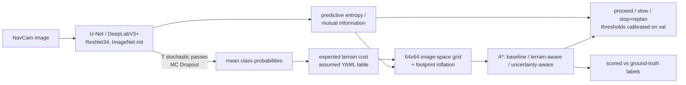

# MARVIS

**Machine Learning-Based Terrain Perception, Uncertainty Estimation, and Traversability Prediction for Planetary Rovers**

MARVIS is a research pipeline built on the NASA/JPL **AI4MARS** dataset (MSL NavCam images with terrain labels).
It segments Mars terrain, quantifies how reliable those predictions are with MC Dropout, studies generalisation,
and then measures how the predictions and their uncertainty change rover path-planning decisions.

> ## ⚠️ Current status: code complete, no real-data results yet
>
> The AI4MARS dataset could not be reached from the development environment: `data.nasa.gov`, `zenodo.org`
> and `huggingface.co` were blocked by its network policy. **No model has been trained on real data, and this
> repository contains no ML results.** Every pipeline stage is implemented and has been tested on a generated
> *software fixture*. Fixture outputs are only used inside tests and are never written to `outputs/`.
>
> To produce real results, get the data ([Dataset setup](#2-dataset-setup)) and run the
> [reproduction commands](#3-reproduce). The dashboard shows "Not run yet" for every result that does not exist.

## Research questions

1. **Perception**: how accurately can a deep model segment planetary terrain (soil, bedrock, sand, big rock)?
2. **Generalisation**: how does performance hold up on held-out rover sites, on expert labels at different
   agreement levels, and under different image conditions (brightness tertiles)?
3. **Uncertainty**: does MC Dropout uncertainty identify the pixels where predictions are wrong
   (error-detection AUROC, risk–coverage / AURC, calibration / ECE)?
4. **Downstream impact**: does uncertainty-aware traversability lead to safer routes than segmentation alone,
   when paths are scored against **ground-truth** labels?

## Architecture



The module dependency graph, artifact table, invariants and the Stage A audit log are in
[docs/ARCHITECTURE.md](docs/ARCHITECTURE.md).

```
configs/      classes, dataset, traversability, experiments/E1..E5
src/marvis/   dataset_index, prepare, dataset, augment, losses, model, uncertainty, metrics,
              train, evaluate, traversability, planner, evaluate_planning, compare, fetch_subset
app/          Streamlit dashboard
scripts/      run.sh (one command per stage)
tests/        unit tests, data-pipeline tests, end-to-end smoke test, dashboard render test
data/         raw/ (not committed), manifests/, weights/ (not committed)
outputs/      generated artifacts (dataset report, experiments, summaries)
```

## 1. Setup (CPU)

```bash
python3 -m venv .venv
.venv/bin/pip install -r requirements-torch-cpu.txt   # CPU-only torch (~200 MB, not ~4 GB of CUDA libraries)
.venv/bin/pip install -r requirements.txt
.venv/bin/python -m pytest -q                          # 70 tests, including an end-to-end smoke test
```

The ImageNet ResNet34 encoder weights are fetched on first use from the timm GitHub release (87 MB) into
`data/weights/`.

> The development container could not reach `download.pytorch.org`, so its venv has the CUDA build from PyPI.
> It works on CPU but carries about 4 GB of unused CUDA libraries.

## 2. Dataset setup

Official sources: [data.nasa.gov](https://data.nasa.gov/dataset/ai4mars-a-dataset-for-terrain-aware-autonomous-driving-on-mars)
and [Zenodo record 15995036](https://zenodo.org/records/15995036). The archive is about 16 GB; you do not need all of it.

**Option A: partial download** (HTTP range requests; only the selected members are transferred):

```bash
# inspect the real archive layout first (reads only the zip directory)
.venv/bin/python -m marvis.fetch_subset --zenodo-record 15995036 --list-only --out data/raw/ai4mars
# ~1000 crowd-labelled training pairs + all official expert-labelled test images, with rover/range masks
.venv/bin/python -m marvis.fetch_subset --zenodo-record 15995036 --n-train 1000 --out data/raw/ai4mars
```

**Option B: existing copy.** Point MARVIS at it with `export MARVIS_RAW_ROOT=/path/to/ai4mars` or
`--raw-root`.

**Expected layout.** Discovery is content-based, so only these path *tokens* matter (set in
`configs/dataset.yaml`):

```
<raw_root>/.../images/edr/*.JPG                       camera images (any directory without the tokens below)
<raw_root>/.../images/mxy/*.png                       rover-body masks       (directory starts with "mxy")
<raw_root>/.../images/rng-30m/*.png                   range masks (>30 m)    (directory starts with "rng")
<raw_root>/.../labels/train/*.png                     crowd-sourced labels   (path contains "labels")
<raw_root>/.../labels/test/<variant>/*_merged.png     expert test labels     (path contains "labels" and "test")
```

Files are paired by a canonical key: the MSL product name with the EDR/MXY/RNG product code and any `_merged`
suffix removed. The inspector reports how many pairs each rule produced.

**Then run:**

```bash
scripts/run.sh data      # = python -m marvis.prepare inspect && python -m marvis.prepare split
```

Check `outputs/dataset/inspection_report.json` **before training**. Confirm that `raw_label_values` and
`mask_unique_values` match `configs/dataset.yaml` (0–3 classes, 255 null, non-zero mask = excluded), and look at
`outputs/dataset/sample_overlays.png`.

Splits:
- The **official expert test set is kept intact**. The primary variant (`min3` agreement by default) is
  `test.csv`; the other agreement levels become `test_<variant>.csv` for generalisation analysis.
- Crowd-sourced labels are split **by rover site/drive group** into train and val, so stereo pairs and
  near-duplicate views never cross splits. Exact duplicates (md5) are removed, and any training image that
  shares a key, md5 or group with test is dropped.

## 3. Reproduce

| Stage | Command |
|---|---|
| Real-data smoke test (1 epoch, 64 images) | `scripts/run.sh smoke` |
| Time one real epoch, then set `epochs` in configs | `scripts/run.sh bench` |
| Baseline E1 | `scripts/run.sh train E1 0` then `scripts/run.sh eval E1_unet_r34_wce_light_s0` |
| All experiments × seeds | `scripts/run.sh all 0 1 2` |
| Aggregate + select demo model (by val mIoU) | `scripts/run.sh compare` |
| Dashboard | `scripts/run.sh dashboard` (= `streamlit run app/dashboard.py`) |

Each underlying CLI is also usable directly (`python -m marvis.train --help`, etc.). An interrupted training run
continues with `--resume`.

### Experiment matrix

| ID | Change vs E1 | Question |
|---|---|---|
| E1 | U-Net / ResNet34, sqrt-inverse-frequency weighted CE, light aug | baseline |
| E2 | DeepLabV3+ (same encoder, loss, data, schedule) | architecture |
| E3 | weighted CE + soft Dice | class imbalance |
| E4 | strong aug (resized crop, photometric, noise, blur) | robustness |
| E5 | plain CE (no class weights) | ablation of weighting |

Deterministic vs MC Dropout is compared inside every run (same weights, same pixels). All runs share the
same manifests and split seed. A result from a single seed is labelled **preliminary** in
`experiments_summary.json` and in the dashboard.

## 4. Evaluation methodology

- **Pixels**: only labelled pixels count. Null, rover-body and beyond-range pixels are ignored everywhere.
- **Segmentation**: one confusion matrix is summed over the whole test split. From it come per-class IoU, Dice,
  precision and recall, plus pixel accuracy. mIoU is the mean over classes present in the ground truth (a
  dataset-level mean, not a per-image mean).
- **Uncertainty score** (higher = less certain): predictive entropy H[E_t p_t] and mutual information
  H[E_t p_t] − E_t H[p_t], both normalised by log C. Confidence = max-class mean probability.
- **Uncertainty quality**: error-detection AUROC (positive = misclassified pixel), risk–coverage curve with
  AURC (shown next to oracle and random references), and ECE with 15 bins plus a reliability diagram. These are
  computed on up to 2M uniformly sampled labelled pixels. They are **not reported** when there are fewer than
  10k pixels or fewer than 100 of either outcome. The evaluation also checks and records that MC samples
  actually vary.
- **Generalisation**: held-out sites (group split), expert-label agreement variants, and brightness tertiles.
- **Efficiency**: median CPU latency for deterministic and MC inference, parameter count, fp32 size.
- **Navigation**: 3 fixed start/goal pairs per test image (rover at bottom centre, goals in the mid field),
  run on at least 30 images where available. Reported per planner: found / success / halted rate, path length
  in grid cells, accumulated predicted and ground-truth cost, fraction of path on ground-truth high-risk
  terrain, ground-truth big-rock cells entered, A* expanded nodes, and mean path uncertainty.
  - *success* = a path exists and never enters a ground-truth majority big-rock cell.
  - The proceed/slow/stop thresholds A/B are the 50th and 90th percentiles of mean path uncertainty on
    **validation**, frozen for test.

## 5. Results

**Not run yet.** This section will be filled from `outputs/experiments_summary.json` and
`outputs/experiments/<run>/planning_summary_test.json` after real training. Nothing here is estimated.

| Experiment | val mIoU | test mIoU | error AUROC | ECE | status |
|---|---|---|---|---|---|
| E1–E5 | — | — | — | — | not run (dataset unavailable in build environment) |

Measured software facts (CPU, 4 threads, 256 px, random-tensor **speed benchmark only**): one U-Net/ResNet34
training step on a batch of 8 takes about 2.2 s, and MC Dropout inference with T=20 takes about 1.3 s per
image. Real epoch time must be measured with `scripts/run.sh bench`.

## 6. Limitations

See [LIMITATIONS.md](LIMITATIONS.md). In short: terrain class is a proxy for traversability, not a measurement
of it. Planning happens in image space with assumed costs, footprint and thresholds. Labels are partly
crowd-sourced. MC Dropout is an approximation. Compute is CPU-scale.

## 7. Future work: ROS 2 integration (design only, not implemented)

A ROS 2 Jazzy package `marvis_ros` with one node, `terrain_costmap_node`:

- **Subscribes** to `/navcam/image_raw` (`sensor_msgs/Image`) and `/navcam/camera_info`.
- **Runs** the TorchScript-exported `MarvisSegNet` with T MC samples on CPU or GPU.
- **Publishes**:
  - `/marvis/costmap` (`nav_msgs/OccupancyGrid`): expected cost + uncertainty weight, scaled to 0–100, with
    big-rock cells set to 100 and unknown cells to −1;
  - `/marvis/uncertainty` (`sensor_msgs/Image`);
  - `/marvis/behaviour` (`std_msgs/String`: proceed / slow / stop).
- **Projection**: unlike this repo, the node would project the grid onto the ground plane using stereo
  disparity or a flat-ground homography from `camera_info` and TF, so the cost grid is in metres.
- **Nav2**: the grid would feed a custom `nav2_costmap_2d` layer plugin (or the static layer via
  `map_server`-style topic). The behaviour topic would drive a BT condition node and a speed-limit filter, so
  that "slow" lowers the controller's maximum velocity and "stop" triggers a replan.
- **Gazebo Harmonic**: a Mars-like world with a rover model (e.g. Curiosity-style rocker-bogie or a
  Husky stand-in) and a camera plugin publishing NavCam-like images. Note that the domain gap between rendered
  and real NavCam images would itself need evaluating.

## Tests

```bash
.venv/bin/python -m pytest -q                  # all tests, including the ~1 min end-to-end smoke test
.venv/bin/python -m pytest -q -m "not slow"    # fast unit tests only
```

The smoke test runs every CLI (prepare → train → evaluate → calibrate → plan → compare → dashboard render) on
a generated 64×64 fixture in a temporary directory. It checks integration only, never metric values.
