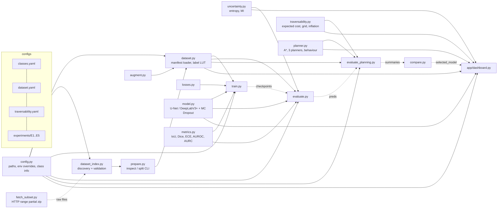

# MARVIS architecture

## Module dependency graph

## Data flow and artifacts

| Step | Command | Writes |
|---|---|---|
| Partial download (optional) | `python -m marvis.fetch_subset …` | `data/raw/ai4mars/…` |
| Inspect | `python -m marvis.prepare inspect` | `outputs/dataset/inspection_report.json`, `sample_overlays.png`, `data/manifests/index.csv` |
| Split | `python -m marvis.prepare split` | `data/manifests/{train,val,test,test_*}.csv`, `class_counts.json`, `split_report.json`, `outputs/dataset/stats.json`, `class_distribution.png` |
| Train | `python -m marvis.train <cfg> --seed S` | `outputs/experiments/<name>_sS/{checkpoints/best.pt,last.pt, history.json, train_summary.json, config.json, train.log}` |
| Evaluate | `python -m marvis.evaluate <run> --split val\|test [--save-preds]` | `metrics_<split>.json`, confusion / reliability / risk-coverage / qualitative / training-curve PNGs, `<split>_preds/*.npz` |
| Calibrate thresholds | `python -m marvis.evaluate_planning <run> --split val --calibrate` | `behaviour_thresholds.json` |
| Planning eval | `python -m marvis.evaluate_planning <run> --split test` | `planning_summary_test.json`, `planning_results_test.csv`, `planner_comparison_test.png` |
| Aggregate | `python -m marvis.compare` | `outputs/experiments_summary.json`, `outputs/selected_model.json` |

Paths can be overridden with `MARVIS_DATA`, `MARVIS_OUTPUTS`, `MARVIS_CONFIGS` and `MARVIS_RAW_ROOT`. Relative
paths resolve against the project root.

## Invariants (checked by tests)

- **Class IDs**: `classes.yaml` defines ids 0..C-1, and `dataset.yaml label_map` must map onto exactly that set.
  `traversability.yaml` must name exactly those classes. Ignore index 255 is never a class
  (`tests/test_config.py`).
- **Ignore handling**: null values, unknown raw values, rover-body pixels and beyond-range pixels all become
  255 in `dataset.load_label`. CE, Dice, the confusion matrix and the uncertainty metrics all skip 255
  (`test_dataset`, `test_model`, `test_metrics`).
- **Normalisation once**: the dataset returns RGB in [0, 1]. ImageNet mean/std is applied only inside
  `MarvisSegNet._encode`, and the dashboard feeds [0, 1] images too.
- **Sizes**: `image_size` comes from the checkpoint config everywhere after training. It must be a multiple of
  `grid_size` (validated in `train.validate_config`).
- **No split leakage**: the official expert test set is never mixed into training. Training images that
  share a key, an md5 or a site/drive group with test are removed, and train/val are split group-wise.
  `prepare.split` asserts no overlap (`test_dataset`).
- **No tuning on test**: the best checkpoint uses val mIoU, the behaviour thresholds use val
  quantiles, and the demo model uses val mIoU. `evaluate_planning --calibrate` refuses test splits.
- **MC Dropout**: BatchNorm stays in eval mode, and only the two `Dropout2d` layers are switched on. The
  test checks that samples vary and that BN running stats are unchanged.

## Audit log (Stage A findings and resolution)

| # | Finding | Resolution |
|---|---|---|
| A1 | `dataset.py` missing: train/evaluate/planning/dashboard crashed on import | Implemented manifest-backed loader |
| A2 | No inspection / split / leakage handling | `dataset_index.py` + `prepare.py` |
| A3 | Class ids assumed from memory, no remapping | Config-driven `label_map`; inspector reports raw values not in config |
| A4 | Proceed/slow/stop thresholds hand-set (risk of tuning on test) | Calibrated on validation; refuses test |
| A5 | Rover / range masks ignored | Mapped to ignore and to blocked planning cells |
| A6 | `matplotlib.cm.get_cmap` removed in installed matplotlib, so dashboard heatmaps crashed | `matplotlib.colormaps[...]` |
| A7 | Grid divisibility only asserted deep inside | Validated at config load |
| A8 | No resume / early stopping / device / reproducibility metadata | Added to `train.py` (git commit, versions, manifest md5, RNG state) |
| A9 | Uncertainty metrics could be reported when undefined | `uncertainty_evaluable` guard (≥10k pixels, ≥100 of each outcome) |
| A10 | Planner: no expanded-node count, no grid validation | `InvalidGridError`, `stats["expanded"]` |
| A11 | Hard-coded output paths | Env overrides |
| A12 | smp 0.5 `load_state_dict` returns `None` (silent partial load possible) | Strict loading |
| A13 | CUDA build of torch installed on a GPU-less machine (4.1 GB unused) | `requirements-torch-cpu.txt`. Unused opencv / scikit-learn removed from requirements. |
